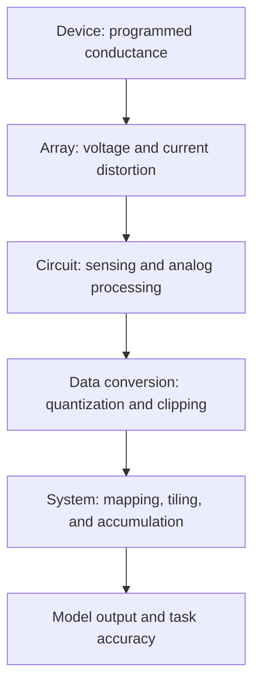

# Cross-layer error propagation

An error introduced in an AIMC device, array, or peripheral circuit can change form as it passes through later stages. Evaluating isolated component error is therefore not sufficient to predict application-level accuracy.

## Propagation path

The diagram below is an original, simplified representation of the signal path. Each stage receives an already perturbed signal and may transform it again.



This ordering does not imply that the errors are independent. Temperature, supply voltage, input data, programmed conductance, and mapping choices can affect several stages simultaneously.

## A compact mathematical view

For a linear layer with ideal output

```text
y = W x
```

perturbations in both weights and inputs produce

```text
(W + ΔW)(x + Δx) - W x
  = ΔW x + W Δx + ΔW Δx
```

The cross term may be negligible when both perturbations are small, but it should not be discarded without checking their magnitude and correlation.

A more complete layer model can be written as

```text
ŷ = QΔ( hckt( farray(W + ΔW, x + Δx) ) )
```

where:

- `farray(·)` represents array-dependent effects such as IR drop, parasitics, and input-dependent current summation;
- `hckt(·)` represents sensing gain, offset, noise, finite swing, and other peripheral-circuit effects;
- `QΔ(·)` represents quantization with step size `Δ`, together with any saturation or clipping.

Because `farray`, `hckt`, and `QΔ` can be nonlinear or data dependent, replacing every non-ideality with independent zero-mean noise may hide important interactions.

## Worked numerical example

Consider one dot product:

```text
W = [1.20, -0.80]
x = [0.50,  1.00]
y = W x = -0.20
```

Assume the programmed weights become `[1.26, -0.76]`. The analog dot product before array and peripheral effects is then:

```text
1.26 × 0.50 - 0.76 × 1.00 = -0.13
```

Next, suppose the array produces a multiplicative attenuation of `0.95`, the sensing circuit contributes an offset of `+0.02`, and the ADC rounds to the nearest `0.10`:

```text
Array output   = 0.95 × (-0.13) = -0.1235
Circuit output = -0.1235 + 0.02 = -0.1035
ADC output     = Q0.10(-0.1035) = -0.10
```

The final absolute error is:

```text
ŷ - y = -0.10 - (-0.20) = +0.10
```

This is an illustrative example, not measured hardware data. It shows three points:

1. The device-level weight error is transformed rather than simply carried unchanged.
2. Multiplicative, additive, and quantization effects act sequentially on the same signal.
3. Near-cancellation in the ideal dot product can make a modest absolute deviation appear as a large relative error, so both absolute and normalized metrics should be reported.

## From one layer to a network

For a multilayer network, a local perturbation can be attenuated or amplified by later transformations. Activation functions, normalization, quantization, residual connections, and data-dependent operating points all influence propagation. A small tensor error at an intermediate layer therefore does not map to a fixed change in classification accuracy.

Useful intermediate metrics include:

- layer-output mean squared error or normalized mean squared error;
- cosine similarity between ideal and non-ideal activations;
- signal-to-quantization-and-noise ratio;
- clipping or saturation rate;
- error distribution by channel, tile, or input class;
- final task metric under the same dataset and preprocessing.

## Suggested evaluation workflow

1. Establish an ideal numerical baseline.
2. Characterize device, array, circuit, and conversion errors under stated operating conditions.
3. Inject one error source at a time to identify sensitivity.
4. Evaluate coupled errors using realistic correlations and operating points.
5. Compare the coupled result with the sum of isolated-error results to expose interaction effects.
6. Report intermediate-layer deviations together with task-level metrics.
7. Repeat across process, voltage, temperature, input statistics, and mapping choices when relevant.

## Reporting cautions

- Do not assume independence when multiple errors share a physical cause or operating condition.
- Do not report only average error when tails, clipping, or rare failures dominate accuracy loss.
- Do not compare task accuracy across different datasets, preprocessing, precision, or retraining conditions.
- State whether calibration or hardware-aware training uses the same non-ideality model as evaluation.
- Distinguish deterministic bias, sample-to-sample variation, temporal noise, and long-term drift.

## Further reading

1. Z. Ding *et al.*, “From device non-idealities to computation accuracy: A cross-layer review of error mechanisms and mitigation in analog in-memory computing,” *Journal of Semiconductors*, 2026. [Official article page](https://www.jos.ac.cn/en/article/doi/10.1088/1674-4926/26060006), DOI: [10.1088/1674-4926/26060006](https://doi.org/10.1088/1674-4926/26060006).
2. P. Mannocci *et al.*, “Achieving high precision in analog in-memory computing systems,” *npj Unconventional Computing*, 2026. DOI: [10.1038/s44335-025-00044-2](https://doi.org/10.1038/s44335-025-00044-2).
3. M. J. Rasch *et al.*, “Hardware-aware training for large-scale and diverse deep learning inference workloads using in-memory computing-based accelerators,” *Nature Communications*, 2023. DOI: [10.1038/s41467-023-40770-4](https://doi.org/10.1038/s41467-023-40770-4).
4. W. Wan *et al.*, “A compute-in-memory chip based on resistive random-access memory,” *Nature*, 2022. DOI: [10.1038/s41586-022-04992-8](https://doi.org/10.1038/s41586-022-04992-8).

See [Mitigation](mitigation.md) and the [repository overview](../README.md).
